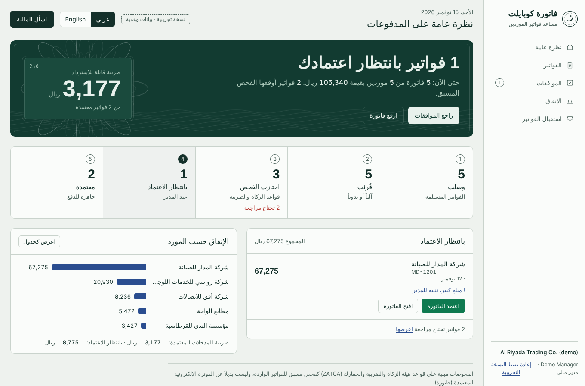
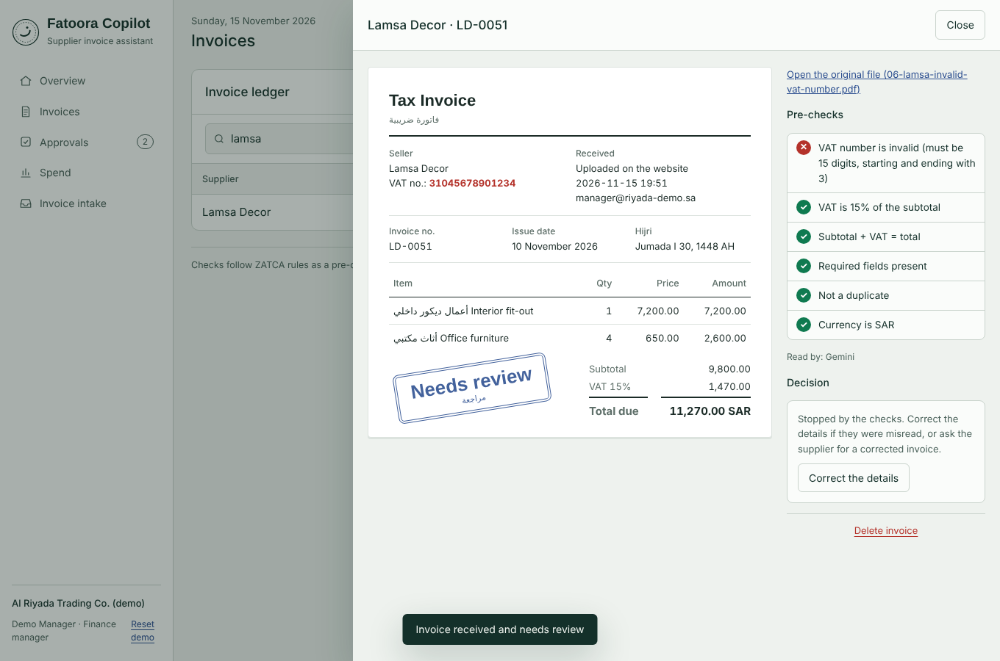
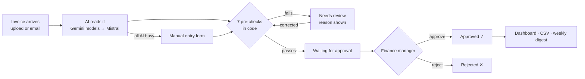

# Fatoora Copilot · فاتورة كوبايلت

**An AI accounts-payable assistant for Saudi finance teams.** Supplier invoices arrive by upload or email, AI reads them in Arabic or English, ZATCA-style pre-checks catch errors before anyone pays, and the finance manager approves with one click.

[](https://github.com/zainismail-dev/fatoora-copilot/actions/workflows/ci.yml)


**▶ [Try the live demo](https://zainismail-dev.github.io/fatoora-copilot/)**: sample data, nothing to install.



---

## The problem

Finance teams in Saudi Arabia still key supplier invoices into spreadsheets by hand, check VAT by eye and chase approvals over WhatsApp. Mistakes like a wrong VAT number, VAT that isn't 15%, totals that don't add up or the same invoice paid twice are found late, often at filing time. ZATCA's e-invoicing rollout keeps adding smaller companies wave by wave, so clean, checked invoices matter more every quarter.

## What it does

| | |
|---|---|
| **Reads invoices with AI** | PDF or photo, Arabic and English. Extracts supplier, VAT number, invoice number, dates (with Hijri), line items and totals |
| **Checks every invoice** | 7 rules in plain code: VAT number format · VAT = 15% · totals add up · required fields · duplicates · currency · large-amount flag |
| **Routes approvals** | Clean invoices go to the finance manager; flagged ones go back to the team with the reason |
| **Never gets stuck** | If an AI model is busy or out of quota, the next one is tried; if all are busy, the invoice opens for manual entry |
| **Works the way finance does** | Arabic-first interface, roles (accountant and manager), search, CSV export, approval emails, weekly digest |



## How it works



**Design decisions**
- **AI reads, code decides.** The model only extracts what is printed. Every pass/fail decision is a plain, tested rule in [`app/checks.py`](app/checks.py), so results are repeatable and auditable.
- **Graceful degradation.** Several AI models in a fallback chain with retries, and a file-hash cache so the same file is never read twice. Email failures never lose an invoice.
- **Security.** Salted PBKDF2 passwords, signed session cookies, login throttling, role checks on every write, one-time approval links that rotate after each decision, and security headers. Tokens and file paths never reach the browser.
- **Small and dependable.** FastAPI and SQLite, with a plain HTML/CSS/JS frontend: no build step and no framework lock-in.

## Tech stack

**Backend:** Python 3.11+, FastAPI, SQLite, httpx · **AI:** Google Gemini (multi-model), Mistral OCR as backup · **Frontend:** HTML, CSS, vanilla JavaScript, Readex Pro and Reem Kufi fonts, RTL-first · **Email:** Gmail IMAP/SMTP · **Quality:** pytest, ruff, Playwright browser tests, GitHub Actions

---

## Run it locally (about 10 minutes)

```bash
git clone https://github.com/zainismail-dev/fatoora-copilot.git
cd fatoora-copilot
python3 -m venv .venv
source .venv/bin/activate          # Windows: .venv\Scripts\activate
pip install -r requirements.txt
cp .env.example .env               # then add your keys (see below)
uvicorn app.main:app --reload
```

Open **http://localhost:8000** and sign in with `ADMIN_EMAIL` / `ADMIN_PASSWORD` from `.env`. Try the files in [`samples/`](samples), four of which contain planted errors. API docs are generated at **/docs**.

**`.env` essentials**

| Setting | What it is |
|---|---|
| `ADMIN_EMAIL`, `ADMIN_PASSWORD` | Your manager login (created on first start; password 8+ characters) |
| `GEMINI_API_KEY` | Free at [aistudio.google.com](https://aistudio.google.com) |
| `GEMINI_MODEL` | One or more models, comma-separated, tried in order |
| `MISTRAL_API_KEY` | Optional backup, free at [console.mistral.ai](https://console.mistral.ai) |
| `SECRET_KEY` | Any long random string |
| `GMAIL_ADDRESS`, `GMAIL_APP_PASSWORD`, `APPROVER_EMAIL` | Optional: invoice inbox, approval emails and Sunday digest ([Gmail app password](https://myaccount.google.com/apppasswords)) |

Add an accountant account: `python -m app.cli add-user sara@company.sa "Sara" clerk`

## Tests

```bash
pytest                                              # 55+ tests: rules, AI fallback, services, auth, API, JS/Python parity
python tools/build_demo.py && node tools/demo_check.js   # end-to-end browser test of the demo site
```

## Project layout

```
app/
  main.py        routes, sessions, roles, security headers
  services.py    receive, check, correct, approve, delete, export
  checks.py      the ZATCA pre-check rules
  extract/       AI reading: model chain, retries, cache, manual fallback
  auth.py        users, PBKDF2 passwords, login throttling
  inbox.py · mailer.py · scheduler.py   Gmail intake, emails, Sunday digest
web/             the app (index.html, app.js, i18n.js, styles.css) and demo.js
docs/            built demo for GitHub Pages (python tools/build_demo.py)
samples/         8 fictional invoices, 4 with planted errors
tests/           pytest suite
```

## Scope

These are **pre-checks on invoices a company receives**. They don't replace ZATCA-certified e-invoicing (FATOORA), which the supplier's own system must handle. All companies and suppliers in this repository are fictional.

---

Built by **Zain Ismail** · AI automation for GCC businesses · [GitHub](https://github.com/zainismail-dev) · MIT License
